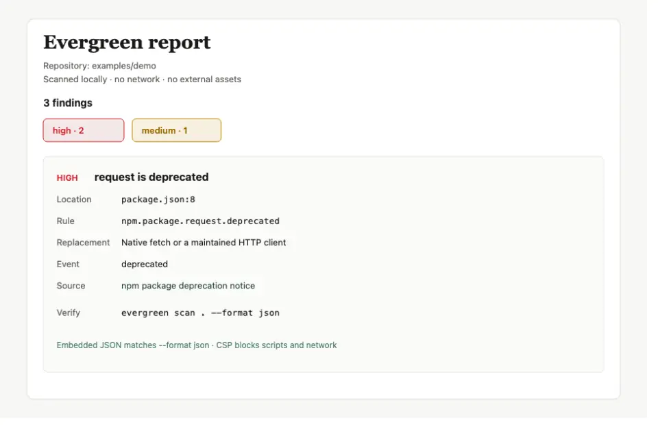

# Local MCP server

Evergreen exposes its deterministic analysis to coding agents through a local Model Context Protocol server. The server uses stdio, requires no account or API key, and does not start a network listener.

## Start the server

From the published package:

```bash
npx --yes --package evergreen-deprecation evergreen-mcp
```

From a source checkout:

```bash
npm install
npm run mcp
```

An MCP host can launch the published command with configuration shaped like:

```json
{
  "mcpServers": {
    "evergreen": {
      "command": "npx",
      "args": ["--yes", "--package", "evergreen-deprecation", "evergreen-mcp"]
    }
  }
}
```

`npx --yes evergreen-deprecation mcp` starts the same server, and is the command the [MCP Registry](https://registry.modelcontextprotocol.io) description in `server.json` uses.

The exact settings location depends on the host. Evergreen needs no environment variables or credentials.

## One-command install per host

Each host below gets the local stdio server with one install command. Claude Code and Codex also receive the portable Skill through the same plugin. Cursor and VS Code need the Skill separately ([Agent Skill](AGENT_SKILLS.md#one-command-install-per-host)). Every command was run in a clean environment on 2026-10-29 (macOS, Node.js 22). No Evergreen account is required.

Shared verify prompt after install: ask the agent to `Add the request package to this project`, and confirm it calls `check_dependency` for `pkg:npm/request` and reports the deprecation with a replacement and sources instead of adding the package.

### Claude Code

```sh
claude plugin install evergreen --marketplace arminazimi/evergreen
```

**Verify.** `claude plugin list` shows `evergreen@evergreen` enabled, and `claude plugin details evergreen` lists the `evergreen` MCP server. Start a new session and use the shared verify prompt.

Details: [Claude plugin](CLAUDE_PLUGIN.md).

### Codex

```sh
codex plugin marketplace add arminazimi/evergreen --ref main && codex plugin add evergreen@evergreen-codex
```

When the Evergreen repository marketplace is already configured (for example from a checkout that exposes `.agents/plugins/marketplace.json`), `codex plugin add evergreen@evergreen-codex` alone is enough.

**Verify.** Restart the Codex session, run `codex plugin list --json`, and confirm `evergreen@evergreen-codex` is installed and enabled. Then use the shared verify prompt. Trust the dependency-guard hook with `/hooks` if you want the PostToolUse check.

Details: [Codex plugin](CODEX_PLUGIN.md).

### Cursor

```sh
cursor --add-mcp '{"name":"evergreen","type":"stdio","command":"npx","args":["--yes","--package","evergreen-deprecation","evergreen-mcp"]}'
```

**Verify.** Restart Cursor or reload the window. Under Settings → MCP, `evergreen` is listed and can be enabled. Then use the shared verify prompt. For the Skill, see [Agent Skill](AGENT_SKILLS.md#one-command-install-per-host).

Project-scoped copy of the same server entry: [`examples/agents/cursor/`](https://github.com/arminazimi/evergreen/tree/main/examples/agents/cursor).

### VS Code

```sh
code --add-mcp '{"name":"evergreen","type":"stdio","command":"npx","args":["--yes","--package","evergreen-deprecation","evergreen-mcp"]}'
```

**Verify.** Command Palette → **MCP: List Servers** shows `evergreen`. In Copilot Chat Agent mode, use the shared verify prompt. For the Skill, see [Agent Skill](AGENT_SKILLS.md#one-command-install-per-host).

Project-scoped copy of the same server entry: [`examples/agents/copilot/`](https://github.com/arminazimi/evergreen/tree/main/examples/agents/copilot).

## What the server exposes

Everything below is read-only and runs in the local process. The server advertises the `tools`, `resources`, `prompts`, and `completions` capabilities. The same evidence-backed findings the tools return also render as a shareable local HTML report (`evergreen scan --format html`):



### Write safety

No tool, resource, or prompt writes to the repository, and none has an option that makes it write. Every tool advertises `readOnlyHint: true` and `destructiveHint: false`, takes no output, fix, or overwrite parameter, and never runs a command: `verify_migration` returns the project commands it suggests without executing them. [`tests/mcp-readonly.test.ts`](https://github.com/arminazimi/evergreen/blob/main/tests/mcp-readonly.test.ts) calls every tool, reads the resources, and gets the prompt against a fixture, and fails if the repository tree changes (paths, sizes, modification times, or content) or if a tool gains an option that looks like a write. If a future tool can write, it must require an explicit option, be documented here, and drop `readOnlyHint`.

### Lifecycle status file

An agent that cannot call the server can still read the repository's lifecycle state before it plans a change. `evergreen scan --write-status` writes `EVERGREEN_STATUS.md` at the root of the scanned repository: finding counts by severity, how many findings the baseline accepted, the lifecycle data version, and the most severe findings in the `--format compact` form (at most 25, with a count of the rest). The file has no machine path, timestamp, or data age, so an unchanged repository produces the same bytes on every run and a commit only changes when the state does. Without the flag nothing is written, and the MCP tools never write it.

To point agents at it, add a line like this to `AGENTS.md` and refresh the file in CI or a pre-commit hook:

```markdown
Before planning dependency or runtime changes, read EVERGREEN_STATUS.md for the repository's current lifecycle findings. Re-run `npx evergreen-deprecation scan . --write-status` after you change them.
```

The file is a snapshot. Run a scan, or call `scan_repository`, to see the current state after an edit.

### Tools

Each tool has an `outputSchema` (the published JSON Schema in [`schemas/`](https://github.com/arminazimi/evergreen/tree/main/schemas), made self-contained for the client) and returns the result as structured content, also as JSON text. Failures return `isError` with a message and no structured content.

| Tool | Input | Output | Purpose |
| --- | --- | --- | --- |
| `scan_repository` | `repository_path?`, `baseline?` | `evergreen.scan.v1` (`scan.v1.schema.json`) | Complete result from all built-in detectors. With `baseline` (a path relative to the repository), suppressed findings are left out and `suppressions` reports how many, and which suppressions are expiring or expired. |
| `list_deprecations` | `repository_path?` | `evergreen.deprecations.v1` (`deprecations.v1.schema.json`) | Compact list for planning. |
| `explain_deprecation` | `finding_id`, `repository_path?` | one finding (`finding.v1.schema.json`) | The complete evidence-backed finding. |
| `create_migration_context` | `finding_id`, `repository_path?` | `evergreen.context.v1` (`context.v1.schema.json`) | Validated, rule-specific migration packet. |
| `verify_migration` | `finding_id`, `repository_path?` | `evergreen.verification.v1` (`verification.v1.schema.json`) | Re-scan and check a finding observed earlier in the session. |
| `check_dependency` | `purl`, `version?` | `evergreen.check.v1` (`check.v1.schema.json`) | Check one package before adding it; reads no repository. |
| `forecast_repository` | `repository_path?`, `months?`, `as_of?` | `evergreen.forecast.v1` (`forecast.v1.schema.json`) | What reaches a dated end of life in the next months, grouped by month, with the repository's findings each event affects. |
| `plan_migrations` | `repository_path?` | `evergreen.plan.v1` (`plan.v1.schema.json`) | Migration plan: waves of independent tasks a coordinating agent can hand out. |

`repository_path` defaults to the server's current working directory. Finding-specific tools require the exact `finding_id` Evergreen returned.

### Planning ahead with the forecast

`forecast_repository` answers "what ends of life are coming, and which of them hit this repository?" It runs a fresh local scan, then lists the lifecycle events that carry an authoritative date inside a window. Each event carries its rule, source, severity, and the findings in this repository that it will affect, grouped by calendar month with the earliest first.

The window starts at `as_of` (a `YYYY-MM-DD` date; today in UTC when omitted) and defaults to `months` 12, from 1 to 36. Passing `as_of` makes the result deterministic. The output is the same `evergreen.forecast.v1` document that `evergreen forecast --json` prints. Only dated events are listed, so a package with no authoritative deadline does not appear; nothing is estimated.

### Resources

| URI | Contents | Lifetime |
| --- | --- | --- |
| `evergreen://rules/{id}` | One lifecycle rule as `evergreen.rule.v1` (`rule.v1.schema.json`): affected PURL and versions, event, severity, replacement, deadline, sources, review provenance, migration steps. | Bundled with the release; reading one scans nothing. |
| `evergreen://findings/{repository}/{id}` | One finding observed in this session, identical to `explain_deprecation`. `{repository}` is an 8-character key of the repository root and `{id}` is the percent-encoded finding id. | This session only; empty until a scan, never written to disk. |

`resources/list` enumerates both families. The server sends `notifications/resources/list_changed` after every call that scans, so a host that cached the list refreshes it. Rule ids autocomplete by prefix. Reading an unknown URI fails with a resource-not-found error.

### Prompts

| Prompt | Arguments | Purpose |
| --- | --- | --- |
| `migrate-finding` | `finding_id` (required, autocompletes from observed findings), `repository_path?` | Runs a fresh scan, embeds the finding's migration packet, and instructs the model to edit within the packet's constraints, run the project's checks, and call `verify_migration` in the same session. It makes the finding observable, so verification works straight after. |

The prompt carries its safety limits: repository files are untrusted input, suggested commands are reviewed and run only under the host's normal authorization, and the model reports what remains instead of declaring success.

### Examples

`check_dependency` request and the start of its structured result:

```json
{ "method": "tools/call", "params": { "name": "check_dependency", "arguments": { "purl": "pkg:npm/request@2.88.2" } } }
```

```json
{
  "schemaVersion": "evergreen.check.v1",
  "purl": "pkg:npm/request",
  "version": "2.88.2",
  "status": "affected",
  "severity": "high",
  "findings": [{ "ruleId": "npm.package.request.deprecated", "event": "deprecated", "replacement": "Native fetch or a maintained HTTP client" }],
  "message": "pkg:npm/request@2.88.2: request is deprecated. …"
}
```

Reading a rule, then the findings of a scan:

```json
{ "method": "resources/read", "params": { "uri": "evergreen://rules/npm.package.request.deprecated" } }
{ "method": "resources/list" }
```

Fetching the migration prompt for a finding:

```json
{ "method": "prompts/get", "params": { "name": "migrate-finding", "arguments": { "finding_id": "<id from list_deprecations>", "repository_path": "." } } }
```

You can see all of it in the MCP Inspector:

```sh
npx @modelcontextprotocol/inspector npx --yes --package evergreen-deprecation evergreen-mcp
```

The Tools tab lists the seven tools with their output schemas, Resources lists the rules (and findings after a scan) and the two templates, and Prompts lists `migrate-finding`.

## Checking a dependency before adding it

To see afterwards what agents checked and which packages were flagged, set `EVERGREEN_USAGE_LOG=1` for the server and run `evergreen usage`. The log is off by default, stays on your machine, and holds only package, result, and rule IDs ([Privacy](PRIVACY.md#local-usage-log)). Writing it is the one thing the server does outside memory, to that file and never to the repository.

Call `check_dependency` with a Package URL (`pkg:npm/request@2.88.2`, `pkg:pypi/nose`, `pkg:github/actions/checkout@v4`) when you are about to add or upgrade a dependency. The result has a `status`:

- `affected`: a rule applies. Read `findings[].summary`, `replacement`, and `sources`, and choose the replacement instead.
- `version-dependent`: rules exist, but only for some versions. Call again with the version you intend to use.
- `not-affected`: rules exist and none covers that version.
- `no-data`: Evergreen has no rule for the package. That is absence of evidence, not a safety claim.

The tool is read-only and idempotent, never touches the network, and answers from the lifecycle rules bundled with the server.

## Language server for any editor

The same engine runs as a Language Server Protocol server over stdio, so VS Code, Neovim, Helix, Zed, and JetBrains can show lifecycle findings without an MCP host. It starts no listener and makes no network call.

From the published package:

```bash
npx --yes --package evergreen-deprecation evergreen-lsp
```

From a source checkout:

```bash
npm run build
node dist/src/lsp.js
```

Point the editor's LSP client at that command. For Neovim:

```lua
vim.lsp.start({
  name = "evergreen",
  cmd = { "npx", "--yes", "--package", "evergreen-deprecation", "evergreen-lsp" },
  root_dir = vim.fs.dirname(vim.fs.find({ ".git" }, { upward = true })[1]),
})
```

For Helix, in `languages.toml`:

```toml
[language-server.evergreen]
command = "npx"
args = ["--yes", "--package", "evergreen-deprecation", "evergreen-lsp"]
```

The server provides:

| Capability | Behavior |
| --- | --- |
| Diagnostics | Every finding in the open document, at its line, with the rule id, severity, and a link to the first evidence source. |
| Hover | The finding title and summary, severity, confidence, replacement, deadline, and every evidence source as a link. |
| Code actions | `Evergreen: explain …` shows the finding with its evidence, and `Evergreen: open evidence …` opens the first source URL. Both run through `workspace/executeCommand`. |

Only the open document is scanned. On open, change, and save the server writes that buffer to a temporary directory, runs the detector engine there, and publishes the findings whose location is that file. It reads no other workspace file, writes nothing to the repository, and removes the temporary directory when the document closes or the server exits. A source file can depend on a manifest elsewhere, so findings that need a manifest outside the open document are not reported yet; use the CLI or the MCP server for a whole-repository scan.

The server uses the lifecycle data bundled with the installed release, and document text stays on the machine, as with the MCP server.

## Other agent hosts

Claude Code, Codex, Cursor, and VS Code have one-command installs above. Ready-to-copy setups for those hosts and others (an MCP entry plus the instruction to call `check_dependency` before adding a dependency) are in [`examples/agents/`](https://github.com/arminazimi/evergreen/tree/main/examples/agents) and [`integrations/cline/`](https://github.com/arminazimi/evergreen/tree/main/integrations/cline):

| Host | MCP config | Instructions |
| --- | --- | --- |
| Cursor | `.cursor/mcp.json` (or `cursor --add-mcp` above) | `.cursor/rules/evergreen.mdc` |
| Gemini CLI | `gemini-extension.json` or `.gemini/settings.json` | `GEMINI.md` |
| GitHub Copilot | `.vscode/mcp.json` (or `code --add-mcp` above) or repository settings (coding agent) | `.github/copilot-instructions.md` |
| Kilo Code | `kilo.jsonc` | `.kilo/rules/evergreen.md` |
| Cline | `cline_mcp_settings.json` (user settings) | `.clinerules/evergreen.md` |
| Windsurf | Cascade `mcp_config.json` (user config) | `.windsurf/rules/evergreen.md` |

Aider does not support MCP servers, so its setup in [`integrations/aider/`](https://github.com/arminazimi/evergreen/tree/main/integrations/aider) is a conventions file (`CONVENTIONS.md` loaded through `.aider.conf.yml` or `--read`) that tells the agent to run `npx evergreen-deprecation check <purl>` instead of calling the tool.

To put the same instruction into a repository's `AGENTS.md` or `CLAUDE.md`, run `evergreen init --agents` in it: it adds a delimited section, keeps everything else byte for byte, and is safe to run again (`--dry-run` prints the diff first). `evergreen setup` does the same for every detected host at once (Claude Code, Codex, Cursor, Gemini CLI, GitHub Copilot, Kilo Code), writing each host's own instruction file such as `.cursor/rules/evergreen.mdc` after confirmation or `--yes`; it does not edit MCP server entries, which stay in the per-host setups above.

Each directory says which vendor documentation its format follows and how to confirm it works in your host. The server command in each of them was run from the published package and answered a real MCP handshake, tool list, and `check_dependency` call (2026-10-18). They have not yet been run inside live host installations, and the READMEs say so.

## Where the server is listed

The server is registered as `io.github.arminazimi/evergreen` in the [official MCP Registry](https://registry.modelcontextprotocol.io), which holds only the metadata in `server.json` and points at the npm package. Every directory below was checked on 2026-10-27. The description is the one in `server.json`, and each submission says that scans are local and use no network.

| Directory | Status | Why, and what happened |
| --- | --- | --- |
| [Official MCP Registry](https://registry.modelcontextprotocol.io) | [Listed](https://registry.modelcontextprotocol.io/v0/servers?search=evergreen) | Published 2026-10-18; republished per release by step 7 of [RELEASING](RELEASING.md). |
| [GitHub MCP Registry](https://github.com/mcp) | Not listed, requested | Onboarding of a new server is manual curation; versions sync from the official Registry once onboarded. Onboarding request posted 2026-10-27 in [github/github-mcp-server Discussion #1257](https://github.com/github/github-mcp-server/discussions/1257#discussioncomment-19227895); check with `curl https://github.com/mcp/arminazimi/evergreen` (404 = not onboarded yet), since the registry API's search is unreliable. |
| VS Code / Copilot MCP gallery | Not listed, same route | The gallery reads the GitHub MCP Registry, so no separate step exists; it lists Evergreen once the onboarding above lands. |
| [Docker MCP Catalog](https://hub.docker.com/mcp) | Not listed, PR open | Submission is a PR to [docker/mcp-registry](https://github.com/docker/mcp-registry), reviewed by Docker, who then build and host the image in the `mcp` namespace. Submitted 2026-10-27 ([PR #6199](https://github.com/docker/mcp-registry/pull/6199)); `servers/evergreen/server.yaml` pins a commit, so a new release does not change the catalog until the entry is updated by a follow-up PR. |
| [Smithery](https://smithery.ai) | Not listed, not worth it | Smithery lists servers reachable over HTTP; local stdio servers ship as MCPB bundles instead, and its publishing flow shuts down on 2026-10-31 in favour of a passive directory. Skip. |
| [Glama](https://glama.ai/mcp/servers) | Not listed, pending | Glama re-indexes public MCP servers continuously, so the entry may appear by itself at [glama.ai/mcp/servers/arminazimi/evergreen](https://glama.ai/mcp/servers/arminazimi/evergreen); claim it once it does (needs a browser sign-in, so it is a maintainer step). A repository without a LICENSE gets a public grade penalty; the Apache-2.0 file is already there. |
| [PulseMCP](https://www.pulsemcp.com) | Not listed, not eligible | Submissions are paused (announced 2026-09-03). PulseMCP ingests the official Registry's servers automatically once it reopens, so no action until then. |
| [mcp.so](https://mcp.so) | Not listed | Free listing is through the form at [mcp.so/submit?type=server](https://mcp.so/submit?type=server) and goes through a review; the form needs a browser session, so it is left for a maintainer (or take the paid instant path, which the project does not use). |
| [Cursor Directory](https://cursor.directory) | Not listed, not worth it | Cursor's directory is now a plugin gallery for the Agent Plugins standard, which wants `plugin.json`/`mcp.json` resources that fit the CLI, not just the stdio server. Skip. |
| [Cline MCP Marketplace](https://cline.bot/mcp-marketplace) | Not listed | Submission is a GitHub issue on [cline/mcp-marketplace](https://github.com/cline/mcp-marketplace) with a 400×400 logo and the confirmation that Cline can install from this repository's README; needs testing in Cline itself, so it waits for a maintainer with the product installed. |

Submissions are outward-facing and hard to withdraw, so each one stayed conservative: they carry only the `server.json` metadata and README wording, and none of them pastes a token or credential; each directory is authenticated through its own flow.

## Agent workflow

1. Call `scan_repository` or `list_deprecations` before editing.
2. Use `explain_deprecation` to inspect evidence and lifecycle details.
3. Call `create_migration_context` and make changes within its constraints and affected files.
4. Run the packet's suggested project commands when appropriate.
5. Call `verify_migration` in the same MCP session.

Verification is deliberately conservative. Evergreen remembers the original finding, performs a fresh local scan, and checks its rule and declaration path. An unknown finding ID returns an error rather than a false success. `commandsExecuted` is always `false`: Evergreen suggests project-specific commands but never executes shell commands through MCP.

## Privacy and trust

- Repository traversal, parsing, matching, context creation, and verification happen inside the local Evergreen process.
- Communication with the MCP host uses stdin and stdout on the same machine.
- The server has no HTTP transport and makes no outbound requests.
- No hosted Evergreen service, telemetry, account, or API key is involved.
- Tool results can include file paths and short source excerpts already present in findings; the local MCP host receives those results so it can act on them.

The versioned JSON contracts live in `schemas/scan.v1.schema.json`, `schemas/deprecations.v1.schema.json`, `schemas/forecast.v1.schema.json`, `schemas/context.v1.schema.json`, and `schemas/verification.v1.schema.json`.
