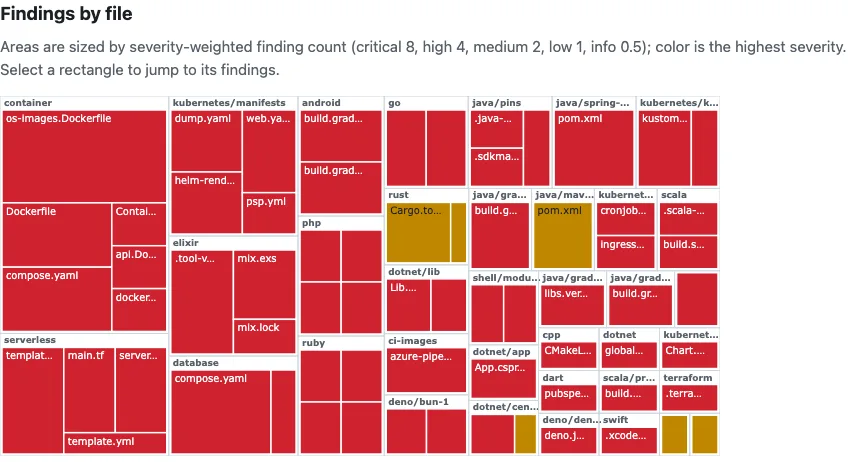

# Share a lifecycle report

Produce a terminal timeline or a self-contained HTML file from a local scan, then send the file yourself. Evergreen never uploads the report, the repository, or the scan result.

Every command below runs offline against files on disk. The examples use the deliberately outdated project at `examples/demo` in this repository; point them at any path you want to scan.

## Terminal timeline

```bash
npx evergreen-deprecation forecast --timeline examples/demo
```

A real run on 2026-10-30 printed:

```text
Forecast from 2026-10-30 to 2027-10-30 (12 months)

2026-10  |
2026-11  |#############################################################  1 event
2026-12  |
2027-01  |
2027-02  |
2027-03  |
2027-04  |#############################################################  1 event
2027-05  |
2027-06  |#############################################################  1 event
2027-07  |
2027-08  |
2027-09  |
2027-10  |
```

Each bar is a month that has at least one dated lifecycle event in the default twelve-month window. Use `--months <n>` to widen or shorten the window, or drop `--timeline` for a plain list. Add `--json` when a tool needs the structured forecast instead of the drawing.

## HTML report

```bash
npx evergreen-deprecation scan --format html examples/demo > report.html
```

Open `report.html` in a browser, attach it to an issue, or paste it into chat. The file is self-contained: styles and the embedded JSON scan result travel with it. Nothing leaves your machine unless you choose to send the file.

### What the report contains

- The repository path Evergreen scanned and when the scan ran.
- A severity summary and every finding: title, severity, exact file path and line, rule id, replacement, and migration notes.
- A treemap that sizes each directory and file by its severity-weighted findings (critical 8, high 4, medium 2, low 1, info 0.5) and colors it by its highest severity; each rectangle links to that file's findings below and shows its path and counts on hover or focus.
- Authoritative source links for each finding (for example the Node.js release schedule or a GitHub changelog entry).
- A "Next 12 months" forecast chart of dated end-of-life events in that window.
- The full scan document in a `<script type="application/json" id="evergreen-report">` block for anyone who wants the machine-readable form.



On `examples/demo`, the report lists findings such as "Unsupported actions/checkout runtime" at `.github/workflows/ci.yml:9` and "request is deprecated" at `package.json`, each with its source URLs.

### What is safe to send

The HTML file (and the timeline text) can include repository-relative paths, finding titles, short excerpts Evergreen already printed, and public evidence URLs. It does not include credentials, environment variables, or file contents beyond those finding fields. Evergreen does not open a network connection for `scan` or `forecast`, does not call home, and does not upload the report anywhere — sharing is only whatever you do with the file or the terminal output after the command finishes.

For the broader privacy contract, see [Privacy](PRIVACY.md).
